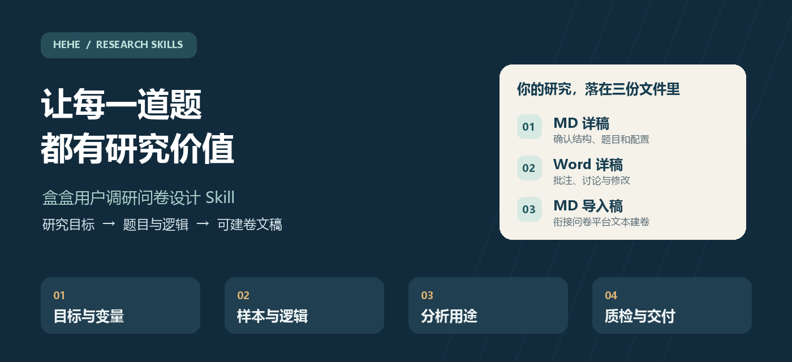
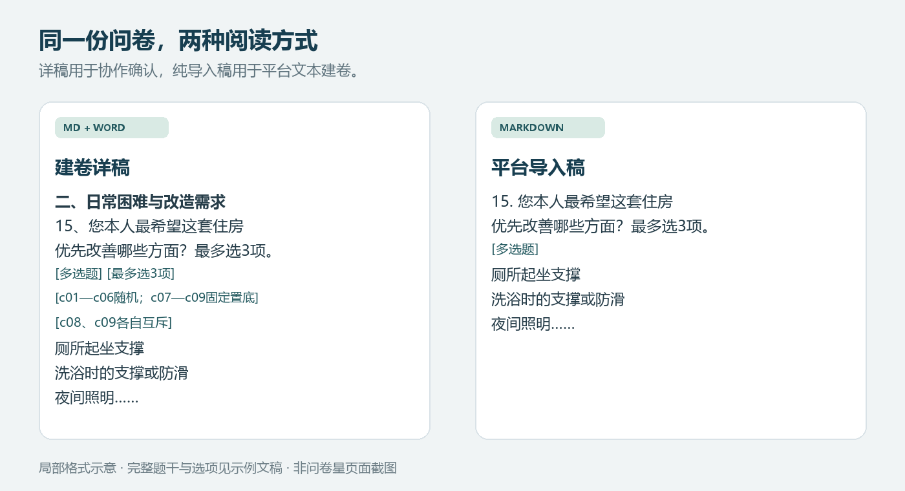

# 盒盒用户调研问卷设计 Skill

> 把一个研究目标，变成一份问得清楚、答得出来、能够支持分析的问卷。



[](LICENSE)
[](https://agentskills.io/)
[](release-manifest.json)
[](#安装与开始使用)
[](#三份文件各有用途)

**`hehe-survey-question-design` 是盒子原创的独立用户研究 Skill。** 它把研究目标拆成问题、变量和题目，设计谁来回答、怎样筛选、怎样分流，以及每个答案将用于什么分析，最终生成供审阅和平台建卷使用的三份文稿。

适合市场研究、用户研究、产品体验、新品需求验证、竞品比较和付费研究。支持从零设计，也支持修改现有问卷、检查漏题和梳理复杂逻辑。

**[查看完整示例](examples/age-friendly-renovation/questionnaire-design.md) · [下载Word详稿](examples/age-friendly-renovation/questionnaire-design.docx) · [查看平台导入稿](examples/age-friendly-renovation/questionnaire-import.md) · [快速开始](#安装与开始使用)**

## 从一句需求，到可以讨论和执行的设计

你可以从这样一句话开始：

> 我想了解猫狗主人的用品需求、使用痛点和购买因素，找到值得优先做的产品机会。

Skill 会把它展开成具体研究工作：

| 你真正想知道的事 | 问卷需要取得的答案 | 后续可以怎样使用 |
|---|---|---|
| 哪些用品值得优先做 | 使用品类、具体场景、遇到的问题和改善优先项 | 找到需求集中、现有方案仍不理想的任务 |
| 谁更需要这个产品 | 宠物和家庭情况、用品使用经历、采购角色 | 比较不同人群的需求，而不只做一张总表 |
| 为什么没有购买 | 当前替代办法、尝试经历、价格与其他阻碍 | 区分没有需求、方案不合适和购买条件不成熟 |
| 什么方案更有吸引力 | 同一口径的概念描述、选择或评价、理由 | 支持产品取舍及后续验证 |

遇到信息缺口，会集中询问那些会改变设计的条件。已经确认的人群、配额和招募信息继续沿用，可以先完成的模块继续推进。

## 适合哪些研究

| 场景 | 重点设计内容 |
|---|---|
| **新品与需求机会** | 场景、任务、当前办法、痛点、改善需求、概念接受度 |
| **产品使用体验** | 实际使用资格、任务表现、具体问题、整体评价与改进方向 |
| **竞品比较** | 品牌经历、可比的使用口径、选择因素、持续或迁移原因 |
| **满意度与流失** | 总体与分维评价、行为经历、问题、继续使用与流失原因 |
| **价格与付费** | 当前支出、决策角色、预算、报价接受或专项价格题组 |
| **B端采购与SaaS** | 使用者、采购者、决策者、组织约束和协作场景 |
| **教育、家庭与多角色研究** | 家长与学生、老人和子女、使用者与付款人的视角区分 |
| **已有问卷修订** | 目标漏测、题意、选项、Base、配额、分流和交付格式检查 |

## 这份 Skill 把力气用在哪里

### 研究问题先行

先明确问卷要支持什么决策，再拆变量和题目。主体题要说明分析用途；筛选、配额和路由题要说明执行作用。缩短问卷时重新检查目标覆盖，保留真正需要回答的问题。

### 把材料加工成受访者能理解的问题

使用项目 brief、历史问卷、访谈、产品资料与必要的公开搜索，提炼具体任务和用户表达。把“清洁不便”展开成缝隙刷不到、拆装费时等不同问题，保留会导向不同产品行动的差别。

### 复杂人群和逻辑能落到题目上

明确本题回答自己、家庭、某个产品还是一家企业；区分已有、潜在、流失用户以及不同决策角色。配额、甄别与分流题放在控制发生之前，普通背景信息通常后置。

详稿能够表达整题显示、单项显示、引用选项、随机范围、固定置底、互斥选项、限选数量和跳转去向。

### 提前考虑答案能否用来分析

每个研究问题对应题号、变量、回答人群和分析用途。设计时就检查：要比较的两组有没有回答同一问题？分流以后还剩多少人？不知道费用和真实零支出有没有分开？

### 方法按问题选择

| 需要解决的问题 | 可选设计 |
|---|---|
| 简单优先项或偏好次序 | 限选、多选、排序、重要性评价 |
| 功能提供与缺失时的反应 | Kano正反题组 |
| 推荐意愿 | NPS及原因追问 |
| 报价接受、价格感知范围 | 单点报价、随机分组、价格阶梯、PSM |
| 多个项目的相对取舍 | MaxDiff任务 |
| 产品属性和价格组合的选择 | 选择型联合分析（CBC） |

专项方法说明按需读取，具体见[专项题组设计](skills/hehe-survey-question-design/references/specialized_question_modules.md)。普通需求问卷可以直接用合适的基本题型完成。

## 八步工作流程


设计底稿保留研究问题、变量、分析用途、字段字典和质检记录。需要设计依据或完整设计包时，可以要求一并提供；日常审阅直接看问卷详稿。

## 三份文件，各有用途



*上图为交付格式示意，不是问卷星页面截图。完整模拟文稿可从下表打开。*

| 文件 | 给谁用 | 包含什么 | 完整示例 |
|---|---|---|---|
| **Markdown建卷详稿** | 研究人员、产品团队、客户 | 设计说明、主题分区、题干选项和简明配置标签 | [阅读MD](examples/age-friendly-renovation/questionnaire-design.md) |
| **Word建卷详稿** | 需要批注、讨论和修改文档的人 | 与MD详稿同版同内容 | [下载Word](examples/age-friendly-renovation/questionnaire-design.docx) |
| **Markdown导入稿** | 问卷平台建卷人员 | 按文本导入格式排列的题目与选项 | [阅读MD](examples/age-friendly-renovation/questionnaire-import.md) |

默认使用问卷星文本导入格式。导入稿可复制到相应文本创建入口；跳转、配额、随机和不支持文本导入的说明，依据详稿在平台完成配置。其他平台可在提出需求时指定。

详稿中的一道题可以这样写：

```text
15、无论是否已经出现困难，您本人最希望这套住房优先改善哪些方面？最多选3项。[多选题][c01—c06随机；c07—c09固定置底][最多选3项][c08、c09各自互斥]
厕所起坐支撑
洗浴时的支撑或防滑
夜间照明
室内门槛通行
床边或座椅旁起身支撑
常用物品取放
其他方面
目前没有想改善的方面
还不能判断
```

内部代码对应原选项顺序，受访者看到的选项不加A/B/C/D前缀。默认必答；不写显示条件时，所有合格受访者回答。

## 完整示例：家庭适老化改造

仓库提供一套**模拟研究设计**：了解老旧小区家庭的改造需求、家庭决策、付费障碍和方案接受度。

| 设计要素 | 本例设置 |
|---|---|
| 研究对象 | 60岁及以上老人本人，或成年子女 |
| 样本设定 | 北京、成都各180户；每城两类身份各90户；每户一人 |
| 问卷体量 | 38个题号、六个主题部分；每人按身份和经历作答 |
| 主要难点 | 使用者、观察者、决策者和付款人可能不同 |
| 设计处理 | 老人回答自身体验；子女回答实际观察；历史改造与未来计划分别记录；总费用、自费和未知分开 |

实际必答封闭题为：老人本人19—34题，近期观察过的子女21—35题，近期未观察的子女20—31题，另有1道选答开放题。示例中的样本、配额与1599元方案均为模拟设定，没有真实招募或回收数据。

## 安装与开始使用

本仓库包含**一个独立Skill**，文件夹名和Skill标识均为 `hehe-survey-question-design`。

```bash
git clone https://github.com/hexiaofeier/hehe-survey-question-design.git
```

把仓库中的 `skills/hehe-survey-question-design/` **整个文件夹**复制到客户端的Skills目录，保留其中全部references。安装后应形成：

```text
你的Skills目录/
└── hehe-survey-question-design/
    ├── SKILL.md
    └── references/
```

例如，Claude Code常用 `~/.claude/skills/`；Codex请使用当前客户端配置的Skills目录。安装后新开会话，确认列表里出现该Skill。

运行环境需要能够读取Skill文件、保存Markdown；交付Word还需要Agent具备DOCX生成能力，例如可用的文档工具或本地代码环境。陌生主题需要补资料时，使用当前Agent已有的搜索或浏览器。没有固定付费插件或其他Skill的安装前提。

### 从零设计

```text
使用 hehe-survey-question-design 设计宠物用品需求问卷。
对象是中国大陆猫狗主人，研究用途是比较用品需求、使用痛点和购买因素。
先集中问我会影响设计的关键问题，再交付MD详稿、Word详稿和MD导入稿。
```

### 产品现场体验

```text
使用 hehe-survey-question-design 设计一款扫地机器人的门店体验问卷。
北京和上海各招募150人，每城三款竞品的用户各50人，
竞品已使用半年以上、购买价格3000元及以上。
家庭需覆盖单身、二人世界、有孩子、有宠物、有老人，不设家庭构成配额。
请区分本品现场体验与竞品日常使用，明确题目、分流和分析用途。
```

### 修改已有问卷

```text
使用 hehe-survey-question-design 审阅我上传的问卷和研究brief。
重点检查必答问题是否漏测、受访者是否知道答案、选项与分流是否合理。
先给问题及修改建议。保留已有有效题目，获确认后同步详稿和导入稿。
```

### 指定专项研究方法

```text
使用 hehe-survey-question-design 设计新服务的价格研究题组。
先判断本题需要单点报价、分组价格测试还是PSM，说明选择理由；
然后明确方案描述、价格单位、回答资格、题目和数据字段。
```

## 已验证到哪里

已经做过职场任务、宠物用品、扫地机器人体验、适老化改造等设计测试。职场任务案例完成过问卷星文本导入及部分分流实测；最新适老化V3完成58项本地路径与文件检查、Word结构检查和MD／Word内容对照。

**首版验证范围：** 最新复杂案例的问卷星实导、Word页面视觉和真人认知预试仍待完成；Kano、价格、MaxDiff、联合分析等新增参考尚未逐方法开展真实项目验收。

## 首版更新内容

**2026-10-02 · v1**

- 完整八步设计流程与七份配套reference。
- 统一MD详稿、Word详稿、MD导入稿三份交付。
- 配额题前置，并明确交叉配额、计入条件和满额处理。
- 内部设计说明与受访者说明分开，影响回答的材料进入实际问卷。
- 按人群与路径检查答题负担，保留分析所需的变量和字段。
- 补充专项题组设计，修正多选共存、功能方法选择与提及率／权重的区别。

升级时，更新整个Skill文件夹，包括references，再新开会话。

## 仓库结构与校验

```text
hehe-survey-question-design/
├── README.md
├── LICENSE
├── release-manifest.json
├── docs/images/                         # 封面与交付示意
├── examples/age-friendly-renovation/     # 模拟问卷三份文稿
├── scripts/validate_release.py
└── skills/hehe-survey-question-design/
    ├── SKILL.md
    └── references/                      # 方法、变量、格式与质检
```

发布包可用Python标准库校验：

```bash
python scripts/validate_release.py
```

校验内容包括Skill名称、配套文件、相对链接、文件哈希、示例同版性和公开包清洁度。

## 盒盒研究工具

本Skill专注一手研究中的问卷设计，独立于[盒盒行业研究技能包](https://github.com/hexiaofeier/hehe-industry-research-skill-pack)。行业和企业公开信息研究可使用行业研究技能包；行业、赛道和企业的比较建模可使用[发展潜力评估Skill](https://github.com/hexiaofeier/hehe-development-potential-assessment)。

**作者：盒子 · hehe** ｜ [GitHub](https://github.com/hexiaofeier) ｜ [反馈问题](https://github.com/hexiaofeier/hehe-survey-question-design/issues)

欢迎带上研究目的、匿名化题目和复现步骤反馈问题。项目采用 [MIT License](LICENSE)；引用的方法资料及外部工具适用各自的条款。
